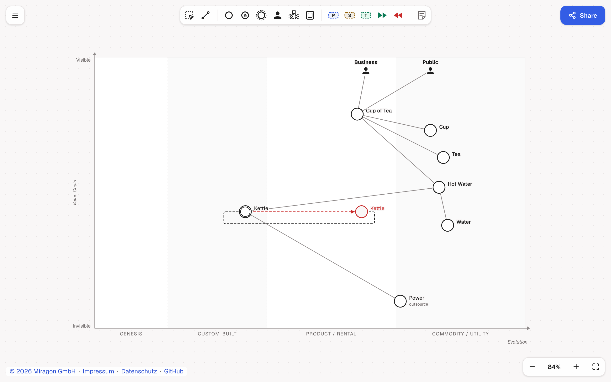

# Wardley Maps

[](LICENSE)
[](https://github.com/Miragon/wardley-maps-modeler/actions/workflows/ci.yml)
[](https://www.npmjs.com/package/@miragon/wardley-renderer)
[](https://marketplace.visualstudio.com/items?itemName=miragon-gmbh.wardley-mapping-modeler)

Create, edit and embed [Wardley Maps](https://learnwardleymapping.com/) — a TypeScript library, a
VS Code extension, and a web app, all built on [diagram-js](https://github.com/bpmn-io/diagram-js).

**[Try the web app →](https://wardley-maps.modeler.miragon.io)**



## Install

```bash
npm install @miragon/wardley-renderer
```

```ts
import { NavigatedViewer } from '@miragon/wardley-renderer';
import '@miragon/wardley-renderer/assets/wardley.css';

const viewer = new NavigatedViewer({ container: document.querySelector('#canvas')! });

await viewer.importDSL(`title Tea Shop
anchor Business [0.95, 0.63]
component Kettle [0.43, 0.35]
evolve Kettle 0.62
Business -> Kettle`);

const map = viewer.exportMap(); // canonical JSON model
const dsl = viewer.exportDSL(); // back to OWM text
const { svg } = await viewer.saveSVG();
```

## What you get

- **Embeddable viewer & modeler** on diagram-js — palette, context pad, move/connect/resize, inline
  labels, undo/redo, evolve-by-drag.
- **Lossless [OWM-DSL](https://docs.onlinewardleymaps.com/) round-trip** and a deterministic JSON model.
- **VS Code extension** — a custom editor for `.wmap` / `.owm` files.
- **Web app** — an Excalidraw-style editor with URL sharing and PNG/SVG picture export.
- **Strict DOM-free core** (model, DSL, transforms) — usable in any JavaScript runtime.
- **Self-hosted fonts** — no CDN, offline-capable.

### Editor interactions

Press `?` in the web app for the same list, with the keys of your platform.

| Action                          | How                                                                                                                                                                                              |
| ------------------------------- | ------------------------------------------------------------------------------------------------------------------------------------------------------------------------------------------------ |
| Quick create                    | `C` component, `U` user/anchor, `N` note, `P` pipeline — at the cursor, or at the view centre without a pointer; placing a node opens its name editor                                            |
| Connect from the selection      | `A` (one selected node), or the context pad                                                                                                                                                      |
| Multi-select (lasso)            | Palette tool, `L`, or `Shift` + drag on the empty canvas                                                                                                                                         |
| Add to selection / select all   | `Shift` + click / `Ctrl/Cmd+A`; `Esc` deselects                                                                                                                                                  |
| Draw lines/shapes               | Palette tool — click point by point; click the last point again (or double-click/`Enter`/`Esc`) to finish, click the start point to close; drag the handles of a selected drawing to move points |
| Copy / paste                    | `Ctrl/Cmd+C`, `Ctrl/Cmd+V` — paste attaches to the cursor; click places, `Esc` cancels                                                                                                           |
| Duplicate (in place)            | `Ctrl/Cmd+D`                                                                                                                                                                                     |
| Delete                          | `Delete` / `Backspace`                                                                                                                                                                           |
| Nudge selection                 | Arrow keys (`Shift` = coarse)                                                                                                                                                                    |
| Undo / redo                     | `Ctrl/Cmd+Z` / `Ctrl/Cmd+Shift+Z` or `Ctrl/Cmd+Y`                                                                                                                                                |
| Zoom                            | `Ctrl/Cmd` + `+` / `-` / `0` (100 %), `Shift+1` fits; the zoom panel bottom-right                                                                                                                |
| Edit label / note               | Double-click (notes: `Cmd/Ctrl+Enter` saves)                                                                                                                                                     |
| Move a label                    | Drag the label; `Alt` + double-click puts it back                                                                                                                                                |
| Edit link annotation/flow value | Double-click the connection (or pencil in the pad)                                                                                                                                               |
| Evolve                          | Drag from the context pad; drag the red target circle                                                                                                                                            |
| Pipeline membership             | Drop a component into/out of the pipeline box                                                                                                                                                    |
| Resize the map                  | Drag the plot's right/bottom edge or corner (`Shift` keeps the ratio, `Alt` turns off snapping); double-click the corner to reset                                                                |

In the web app also:

| Action                      | How                                                                                                                                             |
| --------------------------- | ----------------------------------------------------------------------------------------------------------------------------------------------- |
| Start                       | The start card offers New diagram and Show example; open or drop a file, or open a shared link                                                  |
| Rename the map              | Menu › Map title…; the browser tab and download names follow it                                                                                 |
| Open a file                 | `Ctrl/Cmd+O` or Menu › Open…, or drop a `.wmap` / `.owm` / `.json` file anywhere                                                                |
| Save the map as a file      | `Ctrl/Cmd+S` or Menu › Export as .wmap / Export as JSON                                                                                         |
| Share                       | Share (top right) copies a link that holds the whole map                                                                                        |
| Edit the map as text        | Menu › Edit as OWM-DSL… — edit, then Apply (`Ctrl/Cmd+Enter`); problems are listed by line. Menu › View as JSON… shows the model                |
| Import text or a share link | Paste OWM text or a `#mz=` link onto the canvas                                                                                                 |
| Import problems             | Lines the map could not draw are listed by line behind the problems pill, bottom left                                                           |
| Undo replacing the map      | New diagram, Open…, Show example, paste and Apply replace the map; the "Map replaced · Undo" toast or `Ctrl/Cmd+Z` brings the previous one back |
| Map size, axis labels       | Menu › Map size… (preset, exact width × height, or Reset to default) and Menu › X-axis labels…, previewed live                                  |
| Keyboard shortcuts          | `?` or Menu › Keyboard shortcuts…                                                                                                               |

## Packages

| Package                                                  | Description                                              |
| -------------------------------------------------------- | -------------------------------------------------------- |
| [`@miragon/wardley-schema-model`](packages/schema-model) | Metamodel, Zod validation, deterministic JSON (DOM-free) |
| [`@miragon/wardley-dsl`](packages/dsl)                   | OWM text DSL ↔ model, lossless round-trip (DOM-free)     |
| [`@miragon/wardley-transforms`](packages/transforms)     | Pure `WardleyMap → WardleyMap` transforms (DOM-free)     |
| [`@miragon/wardley-renderer`](packages/renderer)         | diagram-js renderer, viewer, import/export               |
| [`apps/webapp`](apps/webapp)                             | Web editor (demo, deployed on Netlify)                   |
| [`apps/vscode`](apps/vscode)                             | VS Code extension for `.wmap` / `.owm`                   |

## Claude Code plugin

Two Claude skills — the Wardley Mapping method and the OWM text format — ship from this repository
as a Claude Code plugin, so you can use them in any project:

```
/plugin marketplace add Miragon/wardley-maps-modeler
/plugin install wardley-maps-modeler@wardley-maps
```

| Skill             | Covers                                                                                                  |
| ----------------- | ------------------------------------------------------------------------------------------------------- |
| `wardley-mapping` | Simon Wardley's method: evolution, doctrine, gameplay, creating maps, reviews with colour-coded notes   |
| `owm-dsl`         | The `.wmap` / `.owm` format: grammar, coordinates and layout, pipelines, notes, diagnostics, round-trip |

Claude can then read, review, edit and generate `.wmap` / `.owm` maps anywhere — the modeler
renders what Claude writes. Details in [`plugins/wardley-maps-modeler/`](plugins/wardley-maps-modeler/);
the marketplace manifest is [`.claude-plugin/marketplace.json`](.claude-plugin/marketplace.json).

## Fonts

The renderer ships no fonts and loads nothing from a CDN. The typeface is **Geist** (Miragon
corporate identity); provide it yourself — recommended self-hosted via
[`@fontsource`](https://fontsource.org/) (one variable file covers all weights):

```ts
import '@fontsource-variable/geist/wght.css';
```

The variable package registers the family as **`'Geist Variable'`** (not `'Geist'`). The renderer's
font stack (`FONT.family`, set on every SVG `<text>`, and `.wardley-container` in `wardley.css`)
starts with `'Geist Variable', 'Geist', …`, so both that package and a locally installed Geist are
picked up. Use the same name in your own CSS — `font-family: 'Geist', …` alone never matches the
self-hosted face. Without a font the fallback chain degrades cleanly to system sans. Exported SVG/PNG
files only show Geist where the font is available to the program that renders them.

## Supported Wardley elements

<details>
<summary>Coverage against the OWM element reference</summary>

| Element / syntax                                    | Model | Render | DSL ↔ |
| --------------------------------------------------- | :---: | :----: | :---: |
| Component `[visibility, maturity]`                  |  ✅   |   ✅   |  ✅   |
| Anchor / user                                       |  ✅   |   ✅   |  ✅   |
| Dependency `->`                                     |  ✅   |   ✅   |  ✅   |
| Flow `+>` / `+<>` / `+<` / `+'value'>`              |  ✅   |   ✅   |  ✅   |
| Evolution `evolve`                                  |  ✅   |   ✅   |  ✅   |
| Inertia                                             |  ✅   |   ✅   |  ✅   |
| Pipeline `[matStart, matEnd]` + v2 block `{ … }`    |  ✅   |   ✅   |  ✅   |
| Build / buy / outsource (incl. standalone lines)    |  ✅   |   ✅   |  ✅   |
| Market / ecosystem                                  |  ✅   |   ✅   |  ✅   |
| Accelerator / deaccelerator                         |  ✅   |   ✅   |  ✅   |
| Pioneers / settlers / town planners `[v1,m1,v2,m2]` |  ✅   |   ✅   |  ✅   |
| Note (multi-line, colour)                           |  ✅   |   ✅   |  ✅   |
| Annotation (incl. multi-position)                   |  ✅   |   ✅   |  ✅   |
| Submap + `url` definitions / `url(...)` references  |  ✅   |   ✅   |  ✅   |
| Comments `//` and `/* */` (kept via passthrough)    |  n/a  |  n/a   |  ✅   |
| `label [dx, dy]` offsets                            |  ✅   |   ✅   |  ✅   |
| `title` / `style` / `size` / `evolution` / `y-axis` |  ✅   |   ✅   |  ✅   |

</details>

## Contributing

See [CONTRIBUTING.md](CONTRIBUTING.md) for setup and the inner-loop commands.

The VS Code extension has a smoke test in a real VS Code: it packs the extension like the release,
opens a map, edits, saves and undoes through VS Code, and screenshots VS Code's four default themes
into `test-results/vscode-smoke/`. On macOS run `npm run test:vscode` (a VS Code window opens for a
few seconds; the first run downloads VS Code); on Linux `xvfb-run -a npm run test:vscode`. CI runs it
weekly, on demand and on pull requests that change the extension, the DSL or the schema model
([`vscode-smoke.yml`](.github/workflows/vscode-smoke.yml)). See
[CONTRIBUTING.md](CONTRIBUTING.md#vs-code-smoke-test).

## License

[MIT](LICENSE)
